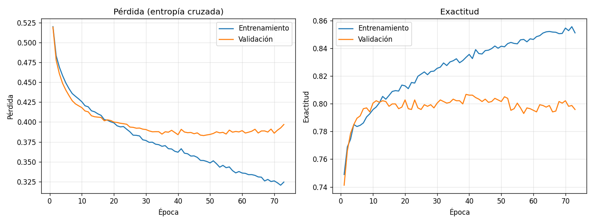

# Tarea 1 — Redes Neuronales: Spaceship Titanic

| | |
|---|---|
| **Alumno** | Nonato Bazán Alberto |
| **Número de cuenta** | 423022225 |
| **Semestre** | Séptimo |
| **Materia** | Sistemas Inteligentes |

## Objetivo
Predecir si un pasajero de la nave *Spaceship Titanic* fue transportado a otra dimensión (`Transported`) a partir de sus datos (planeta de origen, criosueño, cabina, edad, gastos, etc.), usando una **red neuronal**.

## Archivos
| Archivo | Contenido |
|---|---|
| `preprocesamiento.py` | Limpieza, imputación de faltantes e ingeniería de características. |
| `red_neuronal.py` | Perceptrón multicapa implementado **desde cero con NumPy** (forward, backpropagation, Adam, L2, Dropout, early stopping). |
| `main.py` | Entrena, valida, compara y genera la predicción final. |
| `submission.csv` | Predicciones para `test.csv` (mismo formato que `sample_submission.csv`). |
| `resultados/` | Curvas de aprendizaje, matriz de confusión y métricas. |

## Metodología
**Preprocesamiento**
- `PassengerId` → grupo y tamaño del grupo; `Cabin` → cubierta, número y lado; `Name` → apellido y tamaño de familia.
- Imputación lógica: los integrantes de un grupo comparten planeta/cubierta/lado; quien está en criosueño gasta 0; quien gastó dinero no estaba en criosueño.
- Gastos transformados con `log(1+x)`, gasto total, indicador de "sin gasto", rangos de edad.
- One-hot para categóricas y estandarización de numéricas (43 características).

**Red neuronal**
- Arquitectura: 43 → 128 → 64 → 32 → 1 (ReLU en capas ocultas, sigmoide en la salida).
- Pérdida: entropía cruzada binaria. Optimizador Adam (lr = 5·10⁻⁴), L2 = 10⁻³, Dropout = 0.3, mini-lotes de 64.
- Parada temprana con paciencia de 25 épocas sobre la pérdida de validación.
- La retropropagación se verifica numéricamente con diferencias finitas (error relativo ≈ 10⁻⁸).

**Evaluación**
- Partición estratificada 80/20 para curvas de aprendizaje y comparación con regresión logística y el `MLPClassifier` de scikit-learn.
- Validación cruzada estratificada de 5 pliegues; la predicción final es el promedio (ensamble) de las 5 redes.

## Resultados
| Modelo | Exactitud (validación) |
|---|---|
| **Red neuronal NumPy (propia)** | **0.804** |
| MLP scikit-learn | 0.803 |
| Regresión logística | 0.787 |

Validación cruzada de 5 pliegues de la red propia: **0.804 ± 0.007**.



## Ejecución
```bash
pip install -r requirements.txt
python main.py
```
Tarda aproximadamente 40 segundos y regenera `submission.csv` y la carpeta `resultados/`.
